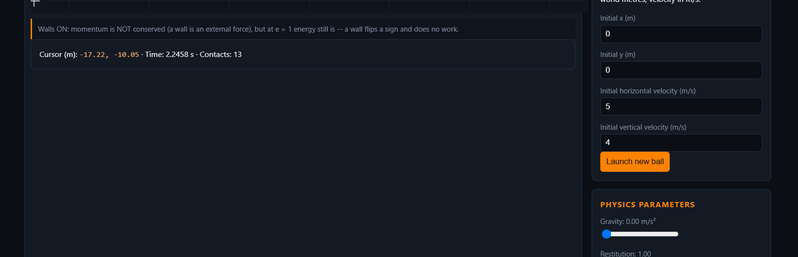
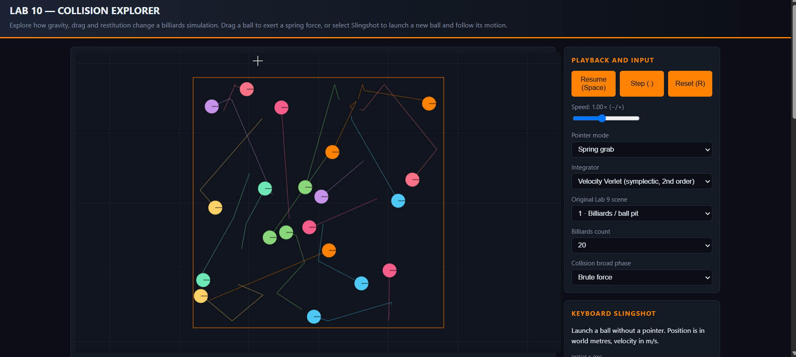
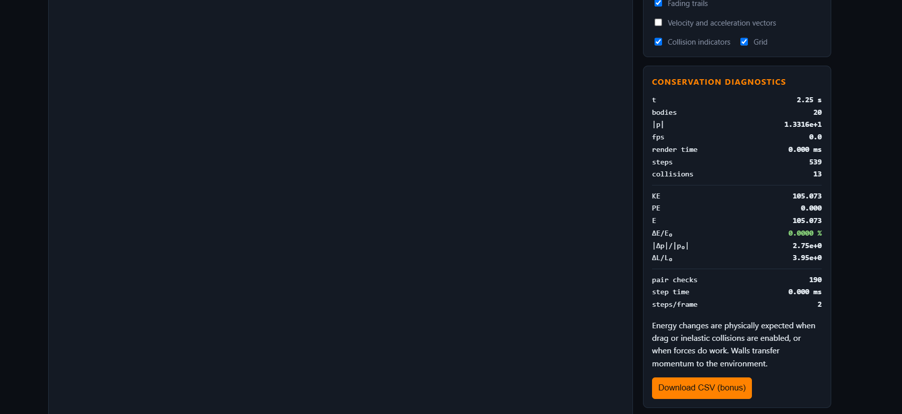

# PHYS 311 — Lab 10: Interactive Simulation

## Overview
For this lab I extended my earlier Lab 9 billiards simulation instead of rewriting its engine. I chose to make a collision explorer, because changing restitution and drag is a direct way to see the difference between elastic collisions and processes that remove mechanical energy. I kept the original physics modules and added separate modules for pointer events and HTML controls.

## Part A: Input and control panel
I implemented `eventToWorld()` using `getBoundingClientRect()` so that pointer locations account for the difference between the displayed canvas dimensions and the internal pixel dimensions. I then use the Lab 9 camera conversion to obtain world coordinates. To make this visible, I added a crosshair at the pointer location and a live cursor readout below the canvas.

**A1 coordinate-verification evidence:** In the new screenshot, the HUD reads **Cursor (m): x = −17.22, y = −10.05**, with simulation time **2.2458 s** and **13 contacts**. The crosshair is visible along the upper edge of this screenshot. I also included a separate, wider screenshot of the simulation to show the crosshair and world grid more clearly. Because the coordinate readout is below the canvas on my laptop, I captured them separately. These screenshots demonstrate that the pointer readout and crosshair are present; they do **not**, by themselves, prove that all four corner values agree with the world bounds. That final corner-by-corner check should be completed in the browser before submitting a claim of full verification.

*Figure 1. Coordinate readout and crosshair near the edge of the simulation canvas (Part A1).*

*Figure 2. Full simulation with the on-canvas crosshair and motion trails.*

*Figure 3. Energy, momentum, simulation timing, and collision diagnostics.*

The simulation can pause, advance one fixed time step (DT = 1/240 s), reset, change speed, and choose Euler, Euler–Cromer, or Velocity Verlet. Changing the speed adds scaled elapsed time to the accumulator but does not alter the fixed integration step. Gravity, restitution, and quadratic drag are live sliders and their values are parsed using `parseFloat`.

The slider ranges are gravity = 0–12 m/s², restitution = 0–1, and quadratic drag = 0–0.2. For the grab spring, k = 60 N/m and a typical moving mass is 1 kg. At DT = 1/240 s, `DT sqrt(k/m)` is about 0.0323, safely below the approximate explicit oscillator condition `DT sqrt(k/m) < 2`. This doesn't eliminate all possible high-speed collision instabilities, but it keeps the spring interaction from being excessively stiff for this time step.

## Part B: Direct manipulation and visualization
I used a damped mouse spring, rather than assigning a ball's position to the pointer. This lets acceleration, velocity, and wall collisions continue naturally. In slingshot mode, dragging determines launch velocity, and the application draws an approximate ballistic preview. For keyboard-only use, a separate form lets a user specify starting position and velocity before launching a ball.

Teleport-dragging is a poor model for two reasons. First, it moves the object without integrating the corresponding force or acceleration, so the displayed trajectory no longer follows Newton's second law. Second, it can cause instant overlaps or penetration of other bodies and walls, making collision responses unrealistic and creating energy discontinuities. **I have not included a claim that I experimentally tested teleport-dragging in the browser.**

My three independent visuals are (1) fading motion trails, which make past paths and deflections visible; (2) velocity/acceleration arrows, which show the direction of motion and the effect of forces; and (3) brief contact flashes around bodies, which make it easier to notice when impacts occur in crowded scenes. The grid is an additional optional visual.

The controls use HTML labels and are reachable by keyboard. The canvas has fallback text and its internal size accounts for device-pixel ratio. **Unplugged-mouse test: [perform and record actual result].** A real touch-device result still needs to be recorded.

## Part C: Focused exhibit and validation
The main purpose is to show visitors how gravity, air resistance, and elasticity change the motion of multiple moving bodies. The two main course topics are (1) numerical integration of Newtonian motion and (2) collisions and conservation laws. The live diagnostics include kinetic/potential/total energy, relative energy drift, total momentum and collision count.

**Quantitative check (headless):** I used my original Lab 9 collisionBox with 20 balls, coefficient of restitution 1.0, no extra gravity or drag, and Velocity Verlet. In 14,400 steps at DT = 1/240 s (60 seconds), I measured 297 ball-ball collision events and **−2.70494 × 10⁻¹⁴ %** relative energy drift. The original Lab 9 headless validation also passed **9 of 9 tests**.

**Robustness log:** The original numerical engine passed its 9 headless checks. The browser-specific abuse sequence (repeated clicking, maximum sliders, drag into walls, resize during run and checking browser Console) has **not yet been verified**. GitHub Pages and phone testing likewise require checking a deployed link, and peer reviews must be completed after examining classmates' actual work.

## Submission checklist
- [x] Actual Lab 9 engine/, render/, scenes/ and tests/ copied into Lab 10
- [x] `input.js` and `ui.js` added outside engine/
- [x] Three parameter sliders, input modes, diagnostics, three visuals, CSV export
- [x] Original headless validations and 60-second conservation test
- [x] Capture coordinate screenshot with live X/Y values and crosshair visible
- [ ] Confirm the readout at all four canvas corners against the expected world bounds
- [ ] Complete unplugged-mouse and mobile checks
- [ ] Execute and record browser robustness checks
- [ ] Publish and verify live GitHub Pages URL
- [ ] Write two evidence-based peer reviews
